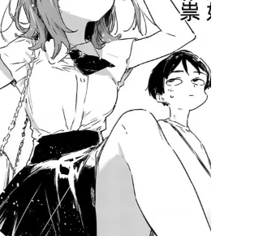
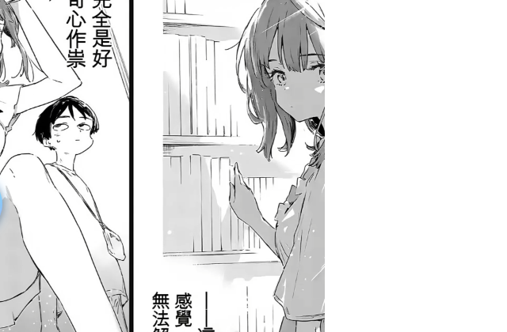
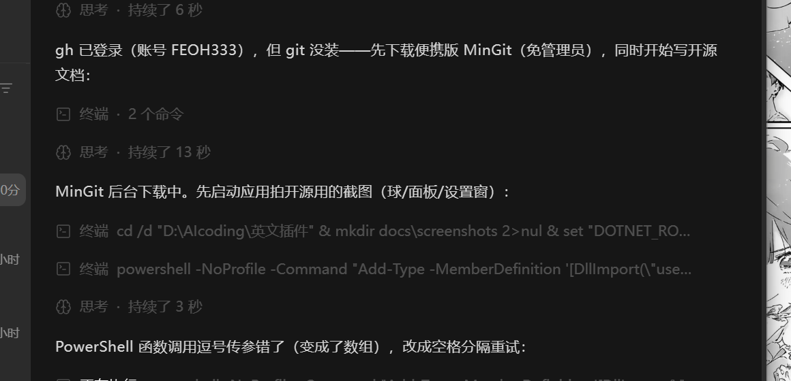

<div align="center">

# 🔮 GlassTranslate 玻璃翻译

**轻量级 Windows 实时 AI 全屏翻译工具 · 液态玻璃悬浮球 · OpenAI / Anthropic 流式翻译**

Lightweight real-time AI screen translator for Windows, with a liquid-glass floating orb.

[](https://github.com/FEOH333/GlassTranslate)
[](https://dotnet.microsoft.com/download/dotnet/8.0)
[](#)
[](LICENSE)
[](../../releases)

**中文** · [English](README.en.md)

</div>

---

## ✨ 这是什么

你是否每天面对大量**英文软件、英文系统界面、英文文档**？
GlassTranslate 在屏幕上留一颗小小的"空心玻璃球"：

- 它**实时检测**屏幕上出现的非中文语句，在**句子旁边的空白处**逐字打出中文译文（流式打字机效果）；
- 也可以按一个**快捷键**整屏翻译一次，再按一次消失；
- 译文气泡**点击穿透**，完全不挡你的操作；
- 支持 **OpenAI** 和 **Anthropic**（Claude）官方 API 与各类中转/网关，多层缓存把成本压到最低。

| 悬浮球 | 展开面板 | API 设置 |
|:---:|:---:|:---:|
|  |  |  |

> 截图为 v1.0.0 实拍（Windows 11, 144 DPI）。

## 📥 安装

### 方式一：直接下载（推荐）

到 [Releases](../../releases) 下载 `GlassTranslate-vX.Y.Z-win-x64.zip`，解压后双击
`GlassTranslate.exe` 即可。**无需安装 .NET 运行时**（自包含发布，约 70MB）。

### 方式二：从源码构建

```bash
git clone https://github.com/FEOH333/GlassTranslate.git
cd GlassTranslate

# 需要 .NET 8 SDK
dotnet build -c Release

# 运行（开发态）
dotnet run -c Release

# 发布独立单文件 exe
dotnet publish -c Release -r win-x64 --self-contained true \
  -p:PublishSingleFile=true -p:EnableCompressionInSingleFile=true -o publish
```

Windows 下也可直接双击仓库根目录的 `build.bat` / `run.bat` / `publish.bat`。

## 🚀 快速开始（3 步）

1. **启动后左键点悬浮球** → 点击 **⚙ 配置 API**
2. 选择服务商（OpenAI / Anthropic），填入 **API Key**（地址可改成中转站），点 **测试连接** 确认 ✓，保存
3. 再点悬浮球 → 开启 **启用实时全屏翻译**——屏幕上出现英文句子，旁边就会逐字打出中文

> 首次使用如果没反应，请看下方 [OCR 前置条件](#-ocr-前置条件一次性)。

## 🖱️ 交互指南

| 操作 | 球态 | 面板态 |
|---|---|---|
| 左键点按 | 向两端展开成面板 | —— |
| 按住拖动 | 移动悬浮球（位置记忆） | 按住空白处/标题行移动整个面板 |
| 右键 | 隐藏悬浮球 / 退出 | —— |
| 鼠标移开 | —— | **5 秒后自动缩回**悬浮球，或点右上角 **✕** 立即收起 |
| 悬停 | 放大 + 高光动效 | —— |

**面板三按钮 + 快捷键框：**

- **⚙ 配置 API** — 弹出设置窗口（服务商 / Key / 地址 / 模型 / 测试连接 / 缓存管理）
- **● 启用实时全屏翻译** — 持续检测屏幕非中文语句，句旁弹出流式译文
- **● 快捷键全屏翻译** + `Ctrl+Alt+T` 小框 — 点击小框**录制任意组合键**（Esc 取消；需含 Ctrl/Alt/Win 之一，或 F1-F24）；按下快捷键整屏翻译，**再按一次译文消失**

**托盘图标**（任务栏右下角，隐藏悬浮球后仍可用）：
右键菜单提供 *显示悬浮球 / 配置 API / 实时全屏翻译 / 快捷键全屏翻译 / 退出*；双击图标显示悬浮球。

## 📄 OCR 前置条件（一次性）

使用 Windows 内置 OCR 引擎（免费、快），需要"英语(美国) OCR"组件（多数机器自带）。

若开启翻译时提示缺引擎，或想自检环境：

```bash
# 无 GUI 自检：显示器/截屏/OCR/过滤器/缓存 全链路体检
GlassTranslate.exe --selftest

# 额外测试已配置的翻译 API
GlassTranslate.exe --selftest --api
```

自检输出会写入 exe 旁 `selftest.log`。缺 OCR 时的安装方法：

> **Windows 设置 → 应用 → 可选功能 → 添加功能 → 搜索"光学字符识别" → 安装〔英语(美国)〕**

## 🔑 API 配置详解

| 字段 | OpenAI | Anthropic |
|---|---|---|
| 默认地址 | `https://api.openai.com/v1` | `https://api.anthropic.com` |
| 默认模型 | `gpt-4o-mini` | `claude-3-5-haiku-latest` |
| 协议兼容 | 任何 OpenAI 协议中转/网关 | 任何 Anthropic 协议中转 |

- **Base URL 自动归一化**：填 `https://你的中转.com`、`.../v1`、`.../v1/chat/completions`、
  `.../v1/messages` 都能识别，直接粘贴中转站给的地址即可。
- **模型名可自由编辑**（下拉只是预设），中转站的新模型直接手输。
- **API Key 安全**：使用 Windows DPAPI（当前用户范围）加密后保存于
  `%APPDATA%\GlassTranslate\config.json`，磁盘上没有明文；换电脑/换用户需重填。
- 网络：直接走系统代理（HTTP_PROXY / 系统代理设置均生效）。

## 💰 成本是怎么省下来的

| 层级 | 机制 | 效果 |
|---|---|---|
| 1. 本地句库 | 每句翻译完成即写入 `%APPDATA%\GlassTranslate\translation-cache.json`；键做了**小写+空白归一化**，"Settings" 与 "SETTINGS" 共享缓存 | 重复句子**零调用、瞬时显示**（软件菜单/报错文案几乎全命中） |
| 2. 提示词前缀缓存 | System Prompt 是固定静态文本（含 100+ 条软件术语表），刻意 >1024 token。Anthropic 显式 `cache_control: ephemeral`；OpenAI 自动前缀缓存 | Anthropic 命中部分 **1 折**，OpenAI **5 折** |
| 3. 批量合并 | 500ms 窗口内的新句子聚成一条请求，最多 16 行/批 | 请求次数 ≈ 屏幕句子数 ÷ 16 |
| 4. 智能跳过 | 画面像素哈希没变就不跑 OCR；纯数字/路径/URL/代码标识符/含中文内容在送翻前被过滤 | 静止画面 **CPU≈0**，API 只花在"真的值得翻"的句子上 |
| 5. 流式输出 | SSE 增量逐字打屏 | 体感延迟 ≈ 首 token 时间 |

## 🏗️ 架构与工程结构

```
├── App.xaml(.cs)            应用入口：单实例、--selftest 分发、异常兜底日志
├── AppController.cs         总装配：UI ↔ 核心的命令/状态枢纽
├── SelfTest.cs              无 GUI 自检
├── Config/AppConfig.cs      配置（JSON + DPAPI 加密 Key）
├── Platform/                原生能力层（全部 Win32 互操作集中于此）
│   ├── Win32.cs             P/Invoke（user32/gdi32/dwm/shell32/crypt32）
│   ├── MessageWindow.cs     隐藏消息窗口：热键 + 托盘回调宿主
│   ├── TrayIcon.cs          托盘图标（WPF 自绘圆环 → HICON，零依赖）
│   ├── HotkeyManager.cs     RegisterHotKey 全局热键
│   ├── WindowEffects.cs     置顶/点击穿透/不抢焦点
│   └── DpApi.cs             API Key 加密
├── Core/                    纯后台核心（零 WPF 依赖，可单测）
│   ├── ScreenPipeline.cs    捕获 → 变化检测 → OCR → 过滤 → 行快照
│   ├── ScreenCapture.cs     GDI 截屏（超大屏自动缩放）
│   ├── OcrService.cs        Windows.Media.Ocr 封装
│   ├── TextFilter.cs        非中文判定 + 缓存键归一化
│   ├── TranslationCache.cs  持久化句库（JSON，可无痛迁 SQLite）
│   ├── TranslationDirector.cs  调度：批处理/流式分发/失败重排
│   ├── PromptCatalog.cs     缓存友好的静态提示词
│   └── Providers/           OpenAI / Anthropic SSE 流式 + N|译文 行协议解析
└── UI/                      WPF 视图层
    ├── BallWindow           悬浮球 ⇄ 面板形态切换（动画核心）
    ├── OverlayController    气泡生命周期 + 智能摆位（下方→上方→右侧→覆盖）
    ├── OverlayWindow        每显示器一个点击穿透画布
    ├── TooltipVm            逐字打字机效果（16ms/帧 字符队列）
    ├── SettingsWindow       API 配置
    └── Toast.cs             右下角提示
```

**数据流（实时模式）：**

```
ScreenPipeline(每1.5s) ──行快照──▶ TranslationDirector ──缓存命中──▶ 瞬发显示
                                      │
                                      └─未命中→ 聚合≤16行 → Provider 流式 SSE
                                              │ "N|译文" 增量
                                              ▼
                                       TooltipVm 字符队列 → 逐字打出
                                              │ 行完整结束
                                              ▼
                                       TranslationCache 落盘（下次零成本）
```

**设计取舍：**

- 为什么 GDI 截屏而不是 Windows.Graphics.Capture？——无需系统黄边/UI 授权弹窗，延迟低，轮询场景足够。
- 为什么"逐字效果"在 VM 的字符队列里做？——网络块大小不可控（有些中转会整段吐出），队列节流后无论网络如何，屏幕上永远是匀速打字机。
- 为什么只有"行完整结束"才写缓存？——半截流不落盘，防止网络中断污染句库。

## ❓ FAQ / 故障排查

<details>
<summary><b>开启实时翻译后没反应</b></summary>

1. 跑 `GlassTranslate.exe --selftest`：确认 OCR 引擎可用、屏幕上确实识别出了英文行；
2. 看是否弹出过 API 错误提示（Key 无效 / 中转地址错误 / 余额不足）；
3. 句子需至少含 3 个英文字母——"OK"、"89" 这类噪声被刻意过滤。
</details>

<details>
<summary><b>快捷键注册失败</b></summary>

被其他软件占用。点击面板上的快捷键小框，按下新组合键重新录制（Esc 取消）。
必须包含 Ctrl / Alt / Win 之一，或使用 F1-F24 单键。
</details>

<details>
<summary><b>译文气泡挡住了图形元素</b></summary>

气泡避让目前只参考 OCR 可见文字（下方→上方→右侧→覆盖原文）。与纯图形重叠是已知局限，
见 Roadmap；临时方案：移动鼠标让对应句子滚出屏幕再滚回来即可刷新摆位。
</details>

<details>
<summary><b>同一句话多处出现只显示一个气泡</b></summary>

v1 以"句子"为键去重（省成本优先）。多位置气泡在 Roadmap 中。
</details>

<details>
<summary><b>换电脑后 API Key 要重填？</b></summary>

Key 用 DPAPI 绑定当前 Windows 用户加密，这是有意为之的安全设计。
</details>

## 🗺️ Roadmap

- [ ] 气泡避让图形元素（前景掩码/目标检测）
- [ ] 同句多位置气泡；气泡手动拖拽与固定
- [ ] SQLite 缓存后端（当前 JSON 足够，>10 万条时迁移）
- [ ] 请求指数退避、429 限速处理
- [ ] 更多目标语言（日/韩）
- [ ] 开机自启

## 🤝 贡献

欢迎 Issue / PR！请先阅读 [CONTRIBUTING.md](CONTRIBUTING.md)。
提 Bug 请附上 `selftest.log` 与 `%APPDATA%\GlassTranslate\error.log`（注意隐去 Key，虽然它们本来就不含）。

## 📜 许可

[MIT](LICENSE) © 2026 FEOH333

## ⭐ 致谢

灵感与参考来自社区的优秀翻译工具：[pot-desktop](https://github.com/pot-app/pot-desktop)、
[STranslate](https://github.com/STranslate/STranslate)、[LunaTranslator](https://github.com/HIllya51/LunaTranslator)、
[openai-translator](https://github.com/yetone/openai-translator)。
